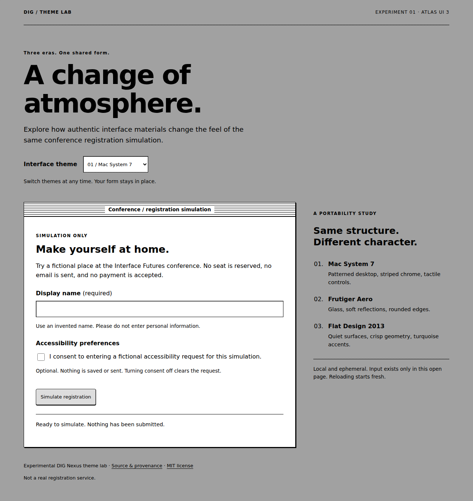
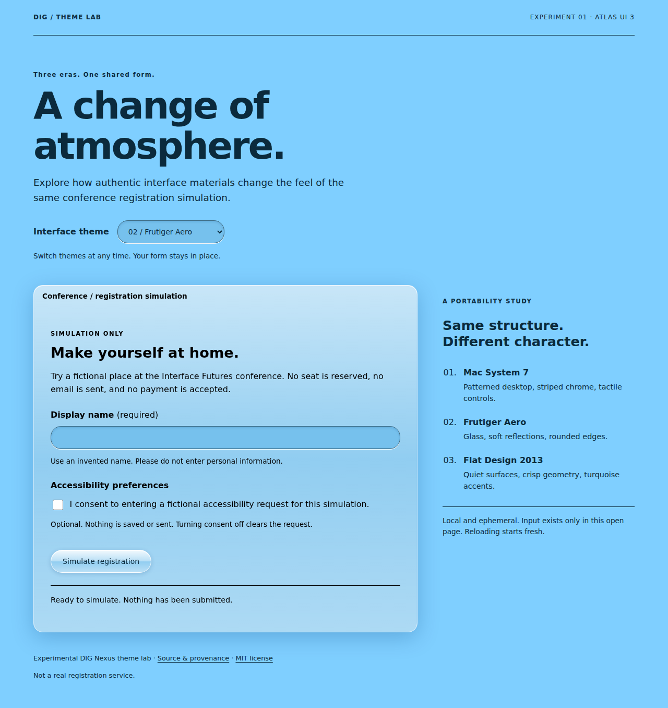
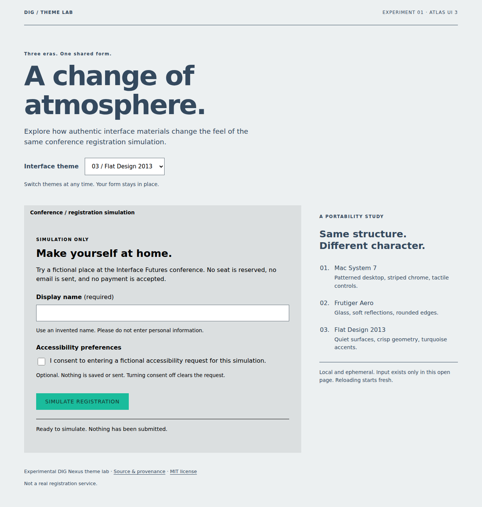

# Atlas UI 3 × DIG Nexus: theme portability lab

One accessible conference-registration **simulation**, three authentic interface
design languages, and one implementation of application behavior.

| Theme | Visual language | Original Atlas ID |
| --- | --- | --- |
| Mac System 7 (1991) | monochrome desktop pattern, striped title bar, tactile borders and buttons | `mac7` |
| Frutiger Aero | layered translucent glass, highlights and rounded controls | `frutiger-aero` |
| Flat Design 2013 | flat panels, rectilinear controls and minimalist typography | `flat-2013` |





## Run locally

Requires **Node.js 22+**. From this directory:

```sh
npm ci
npm run build
npm run build:check
npm test
npx playwright install chromium
npm run test:browser
npm start
```

Open `http://127.0.0.1:4178/` on the same machine. The static server binds
only to loopback, serves an explicit file allowlist, and disallows any dynamic
submission endpoint. No accounts, database, API keys, provider calls, emails,
transactions, or personal data are required or used.

To capture three reference screenshots after installing Chromium:

```sh
npm run previews
```

## Architecture

- `upstream/`: byte-for-byte pinned Atlas UI 3 PR #1175 design assets from
  contributor commit `1f9ba9851a735c9ecdc8d97cee2d61f16f1a8904`.
  These derive from NovusGFX Retro Design System under the accompanying
  [MIT license](upstream/LICENSE); see [source provenance](upstream/SOURCE.md).
- `upstream-hashes.json`: build-time SHA-256 checks for all pinned sources.
- `tokens/semantic.json`: semantic design tokens in DTCG format, compiled
  using **Style Dictionary 5.8.0**, not an invented token compiler.
- `scripts/extract.mjs`: PostCSS AST and selector-parser filtering of genuine
  original Atlas CSS for **only three allowlisted IDs**.
- `scripts/build.mjs`: projects the original source-token values into theme
  scopes, generates the restricted `generated/themes.css` and semantic CSS,
  and checks deterministic output. `build:check` fails on generated drift.
- `index.html`, `app.mjs`, `layout.css`: single accessible form DOM and
  static client behavior, with Atlas CSS classes, original structural
  differences, and narrowly scoped accessibility/reflow rules.
- `tests/`: source-integrity, deterministic-build, no-external-resource,
  accessibility, structural-style, keyboard, mobile and behavioral tests.
- `.github/workflows/theme-lab.yml`: independent validation for this
  experiment. No production DIG Nexus runtime changes.

Switching themes changes only the document's `data-atlas-theme` attribute.
The form node, field IDs, validation, consent, and submission behavior do
**not** change. Text is never saved to storage, sent over HTTP, or copied to a
network service. The accessible review message means only that this **local
simulation** completed. There is no actual DIG membership or registration.

## Acceptance results and limitations

The local experiment should pass all Node tests and five Playwright browser
checks: one accessibility/keyboard/mobile/consent flow for each theme, one
cross-theme DOM/geometry/no-network invariant, and one static server policy
check. Tests use automatic axe-core WCAG 2 A/AA rules; this **does not replace
human Deaf, DeafBlind, ASL, high-zoom and assistive-technology evaluation**.

The extracted themes are from an **unmerged** Atlas contribution and are
strictly version-pinned. Do not assume they are part of an Atlas stable release.
This lab does not enable production DIG Nexus registration or payment features.

All dependencies here are development-only. An npm audit at creation time
reported outstanding moderate advisories in the Style Dictionary dependency
tree; no high or critical advisories after pinning current PostCSS and selector
parser versions. Audit and reevaluate before reuse in a build pipeline that
processes untrusted stylesheets or token sources.

For the security-remediation work, see the separately maintained DIG Nexus PR
#36; this branch is intentionally unrelated.
